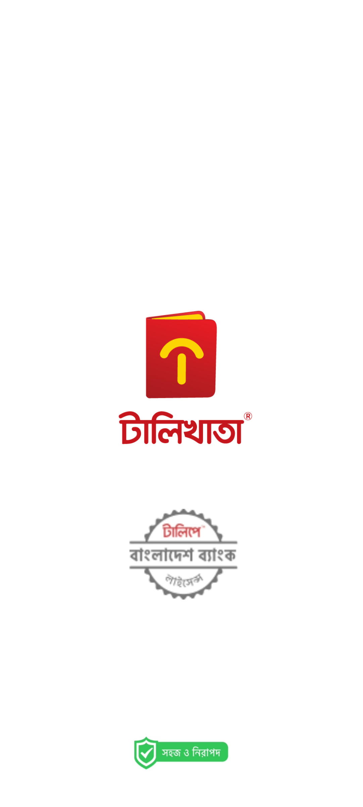
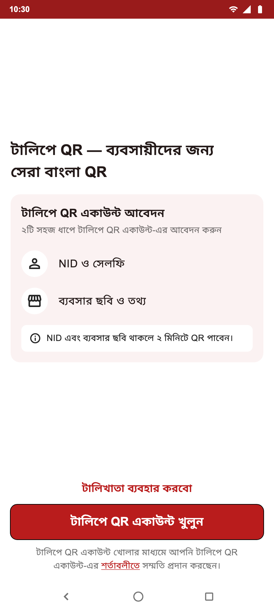
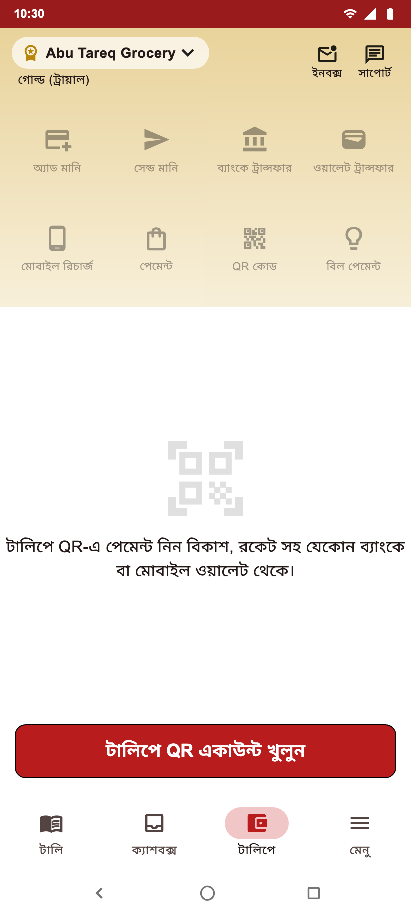
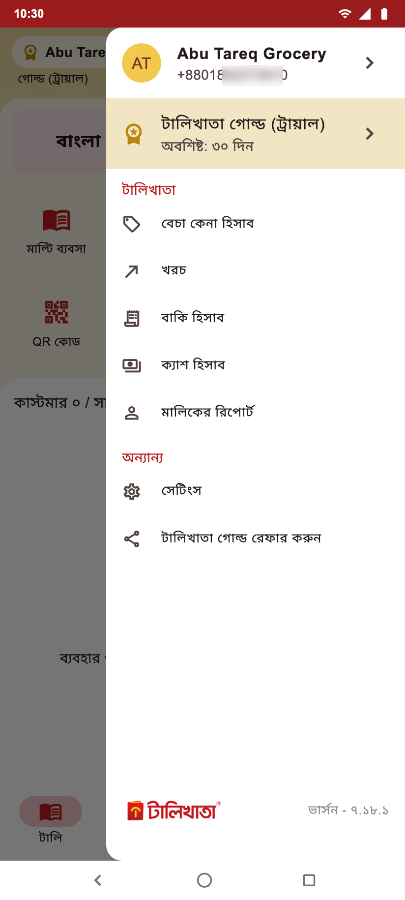
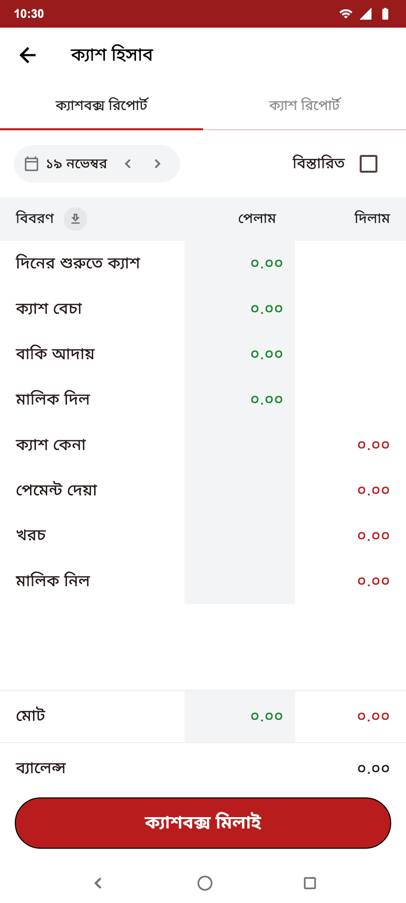
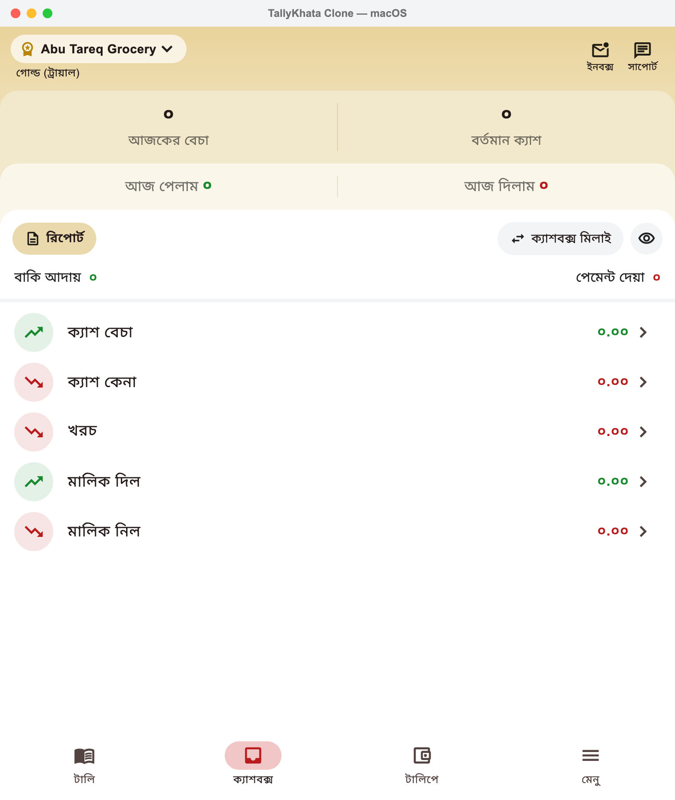

# TallyKhata Clone

A complete digital business ledger (টালি), daily cashbox (ক্যাশবক্স), and TallyPay (টালিপে) super-app interface built with Flutter, Material 3, and Bangla (*Noto Sans Bengali*) typography.

---

## Features

- **Two-Stage Splash & Onboarding Experience (`splash_screen.dart`, `auth_screens.dart`)**:
  - **2-Stage Splash Screen**: Displays the centered TallyKhata icon (`tallykhata_logo.png`) for 1.2s, smoothly transitions via `AnimatedSwitcher` to the full branded splash (`tallykhata_logo1.png`, Bangladesh Bank license badge `tallykhata_logo2.jpg`, and green security shield `tallykhata_logo3.jpg`), and navigates to Login after 3.2s.
  - **Auto-Advancing 3-Slide Onboarding Carousel**: Highlights Bangla QR payments, wallet/bank transfers, and 100% secure transactions with bold NID instructions and highlighted terms (`শর্তাবলীতে`).
  - **Registration & QR Intro**: 11-digit mobile number validation, dynamic business name registration, 30-day TallyKhata Gold trial welcome screen, and 2-step TallyPay QR introduction with a 2-minute instant QR notice box.
- **Dynamic Multi-Business & Profile State (`theme.dart`, `business_screens.dart`)**:
  - Reactive `ValueNotifier<String>` state (`businessNameNotifier`, `userPhoneNotifier`, `businessTypeNotifier`) synchronizes the registered business name, phone number, avatar initials, and 18-category business type across the entire app (including AppBar subtitles in Stock, Notes, and Tagada screens).
  - **User Information (`UserInfoScreen` — আপনার তথ্য সমূহ)**: Accessible directly from the navigation drawer profile header, displaying dynamic avatar initials, business name, phone number, and editable fields (*Name*, *Business Type*, *NID Number*, *Estimated Business Age*, and *Business Address*).
  - **Business Type Picker & Settings**: Includes the **`ব্যক্তিগত হিসাব রাখি`** personal ledger toggle switch, 18-category 2-column business type grid, primary business selector, business editor, and delete confirmation.
- **4-Tab Main Shell & Right-Side Menu Drawer (`main_shell.dart`)**:
  - **Tab 1 — টালি (Tally)**: Layered gold header, rounded cream 8-feature quick action grid (*Multi-Business*, *Stock*, *Business Notes*, *Group Tagada*, *QR Code*, *Data Backup*, *Tally-Message*, *Cashbox*), rounded white body with customer/supplier counters, merchant illustration (`tallykhata_logo9.jpg`), and a red FAB to add customers or suppliers.
  - **Tab 2 — ক্যাশবক্স (Cashbox)**: Layered rounded cards showing *আজকের বেচা*, *বর্তমান ক্যাশ*, *আজ পেলাম*, *আজ দিলাম*, *বাকি আদায়*, and *পেমেন্ট দেয়া*, quick *রিপোর্ট* & *ক্যাশবক্স মিলাই* pill buttons, an **Eye Privacy Toggle** that masks all numbers with `- - -`, and 5 transaction categories (*ক্যাশ বেচা*, *ক্যাশ কেনা*, *খরচ*, *মালিক দিল*, *মালিক নিল*).
  - **Tab 3 — টালিপে (TallyPay)**: 8 wallet action tiles (*Add Money*, *Send Money*, *Bank Transfer*, *Wallet Transfer*, *Mobile Recharge*, *Payment*, *QR Code*, *Bill Payment*) and Bangla QR account registration CTA.
  - **Tab 4 — মেনু (Right-Side Drawer)**: Pure white navigation drawer with profile header, Gold trial banner, report links, *সেটিংস*, *টালিখাতা গোল্ড রেফার করুন*, and bottom footer featuring `tallykhata_logo8.png` and app version.
- **Business Tools & Reports (`feature_screens.dart`, `report_screens.dart`, `misc_screens.dart`)**:
  - **Stock, Notes & Tagada**: Product inventory with unit selector (*কেজি*, *গ্রাম*, *লিটার*, *পিস*, *ডজন*), checklist business notes, and group payment reminders—each displaying the active business name as an AppBar subtitle.
  - **Cloud Backup & Tally-Message**: Cloud backup status checker and SMS pack store.
  - **Financial Reports**: Reusable day/month filterable `ReportScreen` for *বেচা কেনা হিসাব*, *খরচ*, *বাকি হিসাব*, and *মালিকের রিপোর্ট*, plus a 2-tab `CashHisabScreen` (*ক্যাশবক্স রিপোর্ট* & *ক্যাশ রিপোর্ট*) with Bangla date picker, *বিস্তারিত* checkbox, circular download icon, separate shaded *পেলাম* and *দিলাম* columns, *মোট* row, and *ব্যালেন্স* row.
  - **Inbox, Support & Settings**: Notification inbox with detail view, FAQ customer support screen with live chat bar, customer/supplier creation screen, and app settings toggles.

---

## Screenshots (`output/`)

All 32 screens (including both stages of the 2-stage splash screen) are captured across **Android** (`output/android/`), **iPhone** (`output/iphone/`), and **macOS Desktop** (`output/macos/`):

### Splash, Onboarding & Authentication
| Splash Stage 1 (Icon) | Splash Stage 2 (Full) | Login & Onboarding | Business Name | TallyPay QR Intro |
| :---: | :---: | :---: | :---: | :---: |
|  |  |  |  |  |

### Main Tabs & Navigation Drawer
| টালি (Tally Tab) | ক্যাশবক্স (Cashbox Tab) | টালিপে (TallyPay Tab) | মেনু (Navigation Drawer) |
| :---: | :---: | :---: | :---: |
|  |  |  |  |

### Profile, Business Management & Reports
| আপনার তথ্য সমূহ | নতুন কাস্টমার/সাপ্লায়ার | ক্যাশ হিসাব | সাপোর্ট (Support) |
| :---: | :---: | :---: | :---: |
|  |  |  |  |

### macOS Desktop Preview
| Tally Dashboard (macOS) | Cashbox Tab (macOS) |
| :---: | :---: |
|  |  |

---

## Project Structure

```text
lib/
├── main.dart                     # App entry point & MaterialApp configuration
├── routes.dart                   # Centralized route names & WidgetBuilder map
├── theme.dart                    # Brand colors, Hind Siliguri theme & global ValueNotifiers
├── widgets/
│   └── common.dart               # PrimaryButton, EmptyState, backBar, HelpChip, redFab, AppField
└── screens/
    ├── splash_screen.dart        # 2-second splash screen with license & security badges
    ├── auth_screens.dart         # Login carousel, BusinessName, Welcome & QrIntro screens
    ├── main_shell.dart           # MainShell, GoldHeader, TaliTab, CashboxTab, TaliPayTab, MenuDrawer
    ├── business_screens.dart     # NewBusiness, BusinessSettings, BusinessEdit & UserInfo screens
    ├── feature_screens.dart      # Stock, AddProduct, Note, AddNote, Tagada, Backup, TaliMessage
    ├── report_screens.dart       # Reusable ReportScreen (Buy/Sell, Expense, Due, Owner) & CashHisab
    └── misc_screens.dart         # Settings, Inbox, InboxDetail, Support & AddParty screens
```

---

## Getting Started

### Prerequisites

Ensure you have the [Flutter SDK](https://docs.flutter.dev/get-started/install) installed on your machine.

### Installation & Run

1. **Clone the repository:**
   ```bash
   git clone git@github.com-public:mutablesea/Flutter-Development.git
   cd tallykhata_clone
   ```

2. **Install dependencies:**
   ```bash
   flutter pub get
   ```

3. **Run the application:**
   ```bash
   flutter run
   ```

4. **Build release APK (per-ABI lightweight build):**
   ```bash
   flutter build apk --split-per-abi
   ```

5. **Run tests:**
   ```bash
   flutter test
   ```
